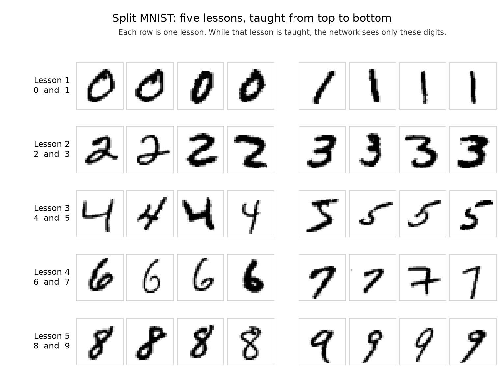
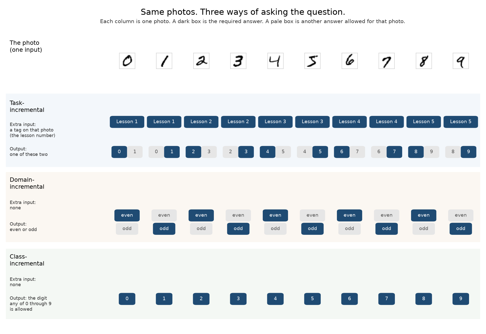
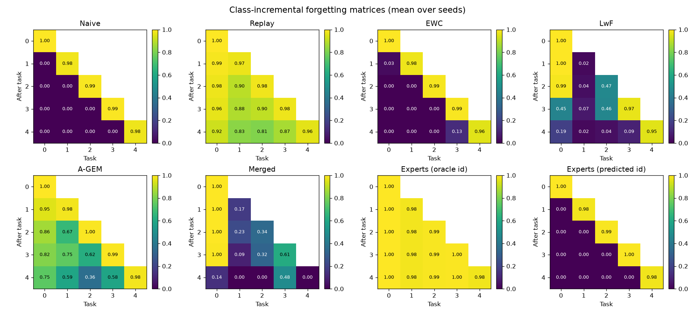
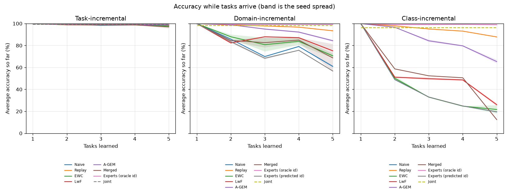
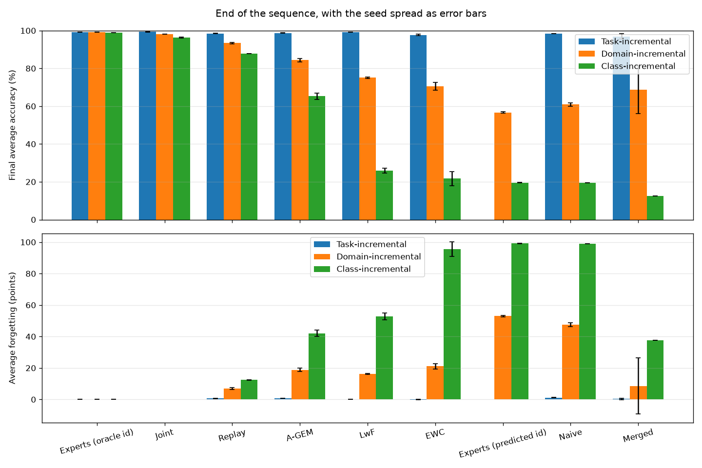
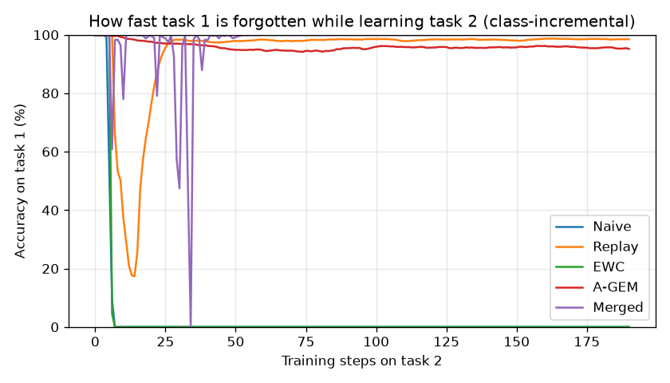
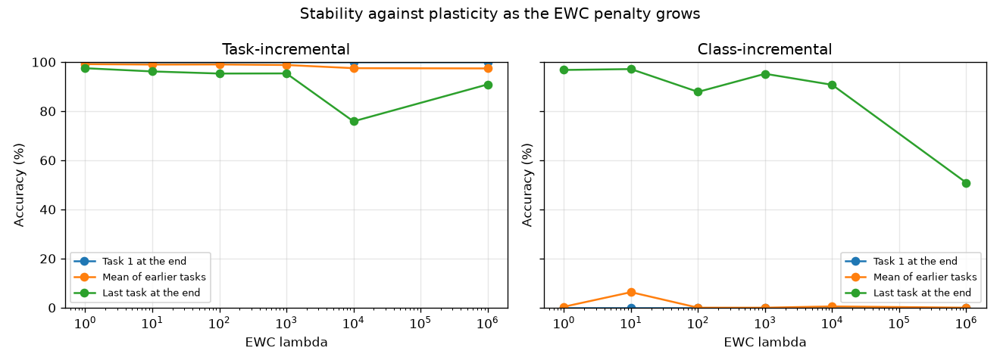
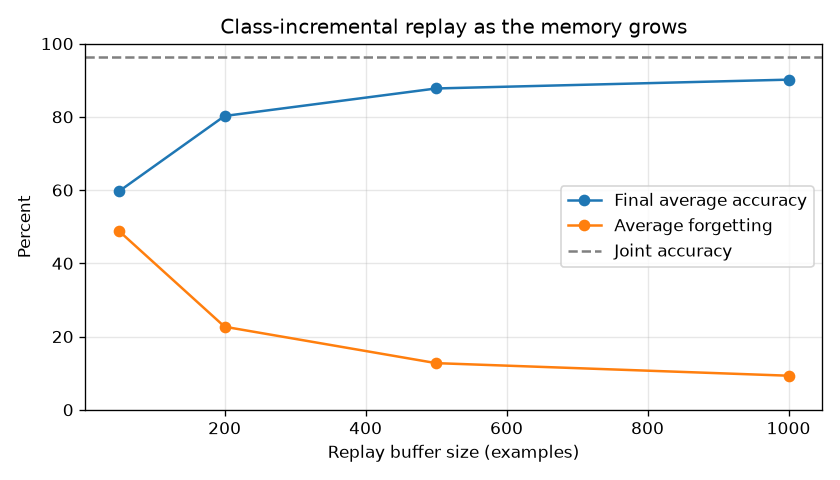

# Split MNIST continual learning

One network learns handwritten digits five lessons in a row, and this page shows each lesson, each question it was asked, and how much of the earlier lessons survived.

- [oricohen.com](https://www.oricohen.com)
- [LinkedIn](https://www.linkedin.com/in/cohenori/)
- [mlcompendium.com](https://www.mlcompendium.com)

The same page is also in [`results/report.html`](results/report.html).

## The five lessons



Each row is one lesson, taught from top to bottom, and while that lesson is running the network sees only that pair.

| Lesson | Photos in that lesson |
| --- | --- |
| 1 | Thousands of 0s and 1s, shuffled together. |
| 2 | 2s and 3s, and this lesson starts only after lesson 1 has finished. |
| 3 | 4s and 5s. |
| 4 | 6s and 7s. |
| 5 | 8s and 9s. |

## What goes in, and what must come out



The same ten photos are used in all three tests, and each column is one photo.

The input is the pixels of that one photo, a dark box is the required answer, and a pale box is another answer still allowed for that same photo.

| Photo | Told the lesson | Even or odd | Name the digit |
| --- | --- | --- | --- |
| 0 | 0, and 1 is also allowed | even | 0 |
| 1 | 1, and 0 is also allowed | odd | 1 |
| 2 | 2, and 3 is also allowed | even | 2 |
| 3 | 3, and 2 is also allowed | odd | 3 |
| 4 | 4, and 5 is also allowed | even | 4 |
| 5 | 5, and 4 is also allowed | odd | 5 |
| 6 | 6, and 7 is also allowed | even | 6 |
| 7 | 7, and 6 is also allowed | odd | 7 |
| 8 | 8, and 9 is also allowed | even | 8 |
| 9 | 9, and 8 is also allowed | odd | 9 |

## How a score is made

| Word | Meaning |
| --- | --- |
| Lesson | Two passes through that lesson's training photos, in batches of about 128, and each batch is one ordinary training step. |
| Score | A separate pile of photos of the same digits, photos that never moved the weights. |
| After a lesson | Every lesson taught so far is scored, and later lessons are still withheld. |
| Final accuracy | The average of those scores after lesson 5. |
| Forgetting | The drop from a lesson's score at the moment that lesson ended to its score after lesson 5. |
| ± | How far three repeats with different random starts spread around the average. |

## The trick in each method

Plain training is the forgetting, because the next lesson moves the same weights. The other rows are the claimed fixes, included so we can see which of them actually keep the old lessons.

| Method | Role | The trick |
| --- | --- | --- |
| Naive | The forgetting | Keep training the same weights on the next lesson, and the old answers get worse. |
| Replay | The ordinary protection | Keep about 500 old photos and mix them into later lessons, so those digits still get practice. |
| EWC | Weight regularization | Save the weights after a lesson, mark which ones that lesson needed, and charge extra for moving those. |
| LwF | Answer regularization | Freeze a copy of the network, and on each new photo pull the live network toward what that copy would say. |
| A-GEM | A check on the step | Keep old photos only as a test of the step, and tilt the step when it would make those photos worse. |
| Merged | All three pulls | On each new photo, charge for moving important weights, pull the answers toward a frozen copy, and tilt the step when stored old photos would get worse. |
| Experts, told the lesson | A separate network per lesson | Freeze each lesson's network when it ends, and let the lesson tag choose which network answers. |
| Experts, guessing the lesson | Same networks, no tag | The frozen networks stay, and a second network guesses the lesson from the photo, then itself forgets. |
| Joint | All lessons at once | Shuffle every lesson into one pile, so no lesson arrives late enough to overwrite another. |

## Scores after each lesson



On the ten-digit test, each square is the share of that lesson's test photos still answered correctly after the lesson named on the left, and yellow is a high score.

| Panel | What the squares do on the ten-digit test |
| --- | --- |
| Naive | Earlier lessons go black as soon as the next lesson starts, and the bright diagonal is only the lesson just finished, near 0.98 to 1.00. |
| Replay | Old lessons stay yellow, and at the end lesson 1 is still about 0.92 while the last lesson is about 0.96. |
| EWC | Old lessons fall to about 0, with a small remainder of about 0.13 on lesson 4. |
| LwF | Pieces of the early lessons linger, then go dark, and the last lesson stays near 0.95. |
| A-GEM | Old lessons fade instead of vanishing, and lesson 1 is still about 0.75 at the end. |
| Merged | On the repeat that finished, the early lessons stay bright until the last lesson, and that last row goes dark, including the lesson just finished at 0.00. Two other repeats left the finite range during that last lesson. |
| Experts, told | Every square stays near 1.00, because each lesson's network is never trained again. |
| Experts, guessing | Later photos go to the newest network, so every earlier lesson ends at about 0. |

## Accuracy as the lessons arrive



Each line is the average score on the lessons taught so far, and the pale band is the spread across the three repeats.

| Panel | What the lines do |
| --- | --- |
| Told the lesson | Every method stays near 100% from the first lesson through the fifth. |
| Even or odd | Plain training falls to 60.9%, replay stays at 93.4%, the told expert stays next to the shuffled line at 98.2%, and the merged line ends at 68.7% with a wide band. |
| Name the digit | Plain training falls to about 20% by the second lesson and stays there, replay stays near 88%, shuffled training finishes at 96.4%, and the merged line ends at 12.4% on the repeat that finished. |

## The end of all five lessons



The top chart is the final average score, and the bottom chart is how many points the earlier lessons lost.

Each number is the average of three repeats, and the second number in a cell is the points lost on earlier lessons. Rows run from the strongest ten-digit score to the weakest.

| Method | Told the lesson | Even or odd | Name the digit |
| --- | --- | --- | --- |
| Experts, told | 99.1% ± 0.1, forgot 0.0 | 99.1% ± 0.1, forgot 0.0 | 98.9% ± 0.1, forgot 0.0 |
| Joint | 99.3% ± 0.1 | 98.2% ± 0.0 | 96.4% ± 0.2 |
| Replay | 98.5% ± 0.1, forgot 0.6 | 93.4% ± 0.4, forgot 6.9 | 87.8% ± 0.0, forgot 12.4 |
| A-GEM | 98.7% ± 0.1, forgot 0.7 | 84.3% ± 0.9, forgot 18.7 | 65.3% ± 1.7, forgot 42.1 |
| LwF | 99.2% ± 0.0, forgot 0.1 | 75.2% ± 0.4, forgot 16.2 | 26.0% ± 1.3, forgot 52.8 |
| EWC | 97.7% ± 0.3, forgot 0.0 | 70.6% ± 2.0, forgot 21.1 | 21.7% ± 3.8, forgot 95.6 |
| Experts, guessing | not run | 56.7% ± 0.4, forgot 53.0 | 19.6% ± 0.0, forgot 99.2 |
| Naive | 98.4% ± 0.1, forgot 1.1 | 60.9% ± 0.9, forgot 47.6 | 19.5% ± 0.1, forgot 99.1 |
| Merged | 96.9% ± 1.4, forgot 0.4 | 68.7% ± 12.6, forgot 8.6 | 12.4% on the finished repeat, forgot 37.7; two repeats left the finite range |

The told expert uses about 1.3 million weights, and the shared network uses about 270 thousand.

Joint has no forgetting number because the lessons were shuffled together.

## Why these methods are here

Slowing forgetting is not how the forgetting is produced. Plain training produces it, and each other method is a claimed way to keep the earlier lessons. Rows follow the same order as the score table, strongest ten-digit result first.

| Method | What the step is doing | What the ten-digit scores showed |
| --- | --- | --- |
| Experts, told | Each lesson is frozen in its own network, so a later lesson cannot change it, and the lesson tag picks which network answers. | It stays at 98.9% and does not forget, because those weights never move again. |
| Joint | The same photos are learned all at once, so no lesson arrives late enough to overwrite another. | It finishes at 96.4%, and the gap beneath that score is the cost of teaching one lesson after another. |
| Replay | A few hundred old photos stay in the later batches, so those digits keep getting practice. | Old lessons stay near the top, and the final score is 87.8%. |
| A-GEM | A training step is a shove of the weights, and tilting it takes out the part of the shove that would make the stored old photos worse. | The tilt keeps some of the old photos, so the score rises to 65.3%, and 42 points of forgetting remain. |
| LwF | The frozen copy is the memory of the old answers, and the live network is pulled back whenever a new photo makes it disagree with that copy. | That pull only lifts the final score from about 20% to 26.0%. |
| EWC | The new lesson still moves the weights, but the ones the old lesson needed cost more to move, so the new lesson mostly changes the others. | That extra charge does not stop the collapse, and the final score stays near plain training at 21.7%. |
| Experts, guessing | The frozen networks stay, and a second network has to guess which one to ask. | The guesser sends photos to the newest network, so the score falls to 19.6%, the same collapse as plain training. |
| Naive | The next lesson moves the same weights, so the old answers get worse. | Old lessons collapse, and the final score is 19.5%. |
| Merged | The three pulls run on the same step: important weights cost more to move, the answers are pulled toward a frozen copy, and the step is tilted when stored old photos would get worse. | Two of three repeats left the finite range on the last lesson. The repeat that finished reached 12.4%, below plain training. |

## How fast lesson 1 disappears



This chart rescores lesson 1's test photos after every training step of lesson 2, on the ten-digit question.

| Method | Lesson 1 while lesson 2 is training |
| --- | --- |
| Naive | Falls from 99.9% to 0% within 19 steps, then stays at 0%. |
| EWC | Falls to 0% on the same early steps, then stays at 0%. |
| Replay | Dips during those early steps, then climbs back near the top. |
| A-GEM | Stays near the top for the whole of lesson 2. |
| Merged | Dips to 0% at step 34, then climbs back to 99.9% and stays there. |

## Turning the EWC penalty up



Each point is one strength of the penalty, from a very light pull to a very heavy one, on a single repeat.

| Penalty | Told the lesson | Name the digit |
| --- | --- | --- |
| Lightest | Lesson 1 stays at 100%, and the last lesson is 97.5%. | Old lessons stay near 0%, and the last lesson is 96.8%. |
| Heaviest | Lesson 1 stays at 99.9%, and the last lesson falls to 90.9%. | Old lessons stay at 0%, and the last lesson falls to 50.9%. |

## A larger pile of old photos



The blue line is the final digit-naming score, the orange line is forgetting, and the dashed line is shuffled training at 96.4%.

| Old photos kept | Final digit score | Forgetting |
| --- | --- | --- |
| 50 | 59.6% | 48.9 |
| 200 | 80.2% | 22.7 |
| 500 | 87.7% | 12.7 |
| 1,000 | 90.2% | 9.3 |

The largest pile is the closest of the four to shuffled training at 96.4%.

## One pass instead of two

| Method | Digit score after one pass | Forgetting |
| --- | --- | --- |
| Naive | 19.3% | 98.9 |
| Replay | 86.3% | 13.2 |

## Run

```bash
python3 -m venv .venv
.venv/bin/python -m pip install -r requirements.txt
.venv/bin/python -m unittest discover -s tests
.venv/bin/python -m cl_toy.run
```

The full run uses three seeds on CPU and writes:

- `results/report.html` — the same report as this page
- `results/summary.md` — measured numbers and whether each expected pattern held
- `results/metrics.json` — accuracy matrices and sweeps
- `results/figures/` — forgetting matrices, learning curves, and sweeps

MNIST is downloaded into `data/` on the first run. The virtualenv and that download stay on the machine. They are not part of the repository.
